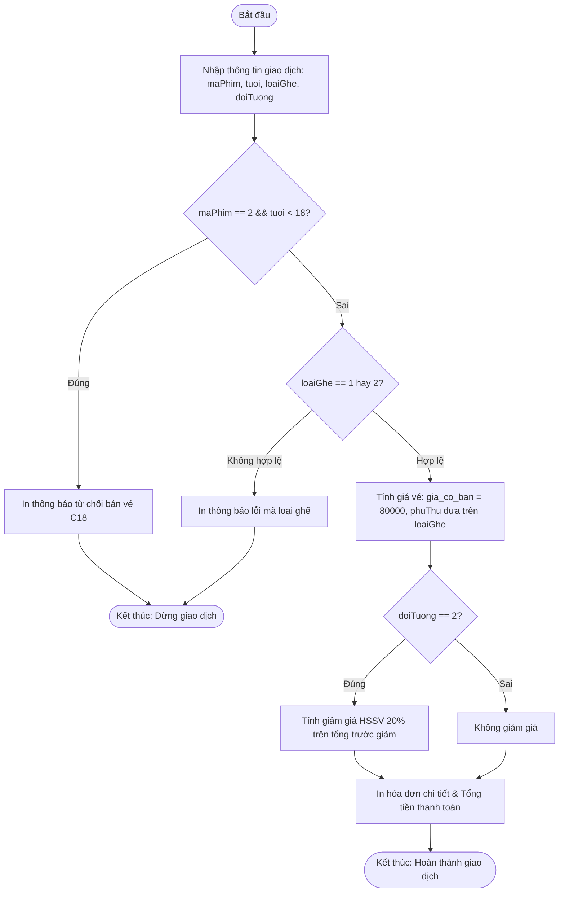

# BÁO CÁO BÀI TẬP THỰC HÀNH 01: XÂY DỰNG MODULE TÍNH TIỀN VÉ XEM PHIM CGV VÀ LOTTE CINEMA

> 👤 **Học viên:** Hoàng Công Dũng | **Mã SV:** PTIT-HCM-009
> 🏫 **Môn học:** it102-rl-hoangcongdung

---

## 📊 Sơ đồ thiết kế hệ thống (Activity Diagram)

> 💡 *Sơ đồ dưới đây được render tự động trực tiếp trên GitHub bằng Mermaid. Bạn cũng có thể tải file **`bt1.drawio`** trong repository này để mở và chỉnh sửa trực tiếp trên [Draw.io (diagrams.net)](https://app.diagrams.net).* 

---

## 1. Mục tiêu và Tổng quan bài toán

Bài tập này giúp em củng cố vững chắc các kiến thức căn bản trong ngôn ngữ lập trình C bao gồm khai báo biến, sử dụng các kiểu dữ liệu nguyên thủy, thao tác với toán tử logic (&&, ||), cấu trúc rẽ nhánh if - else và cấu trúc điều hướng switch-case.

Yêu cầu đặt ra là xây dựng một module Kiosk tự động tính tiền vé xem phim, trong đó phải xử lý chặt chẽ các nghiệp vụ kiểm duyệt độ tuổi khán giả, tính phụ thu theo loại ghế ngồi và chiết khấu ưu đãi cho đối tượng học sinh, sinh viên.

- Tuân thủ tuyệt đối cấu trúc thư mục lab_session03 và tập tin mã nguồn main.c.
- Kiểm tra kỹ lưỡng các bẫy dữ liệu như khán giả dưới 18 tuổi xem phim C18 hoặc nhập sai mã loại ghế.

## 2. Phân tích Thuật toán và Xử lý Nghiệp vụ

Quá trình xử lý của chương trình được chia thành các tầng logic rõ rệt để đảm bảo không xảy ra sai sót trong quá trình tính tiền.

Đầu tiên, hệ thống tiếp nhận 4 tham số đầu vào từ bàn phím gồm mã phim, tuổi khán giả, loại ghế và đối tượng. Bước kiểm tra đầu tiên được kích hoạt ngay lập tức để chặn các giao dịch vi phạm thuần phong mỹ tục hoặc quy định pháp luật đối với phim nhãn C18.

- Kiểm duyệt độ tuổi: Nếu maPhim bằng 2 và tuổi nhỏ hơn 18, chương trình in thông báo từ chối phục vụ và dùng lệnh kết thúc luồng.
- Phụ thu ghế: Sử dụng cấu trúc switch-case để kiểm tra biến loaiGhe. Ghế Thường (mã 1) có phụ thu 0 đồng, Ghế VIP (mã 2) phụ thu 15.000 VNĐ. Nếu nhập khác các giá trị này, hệ thống báo lỗi.
- Chiết khấu ưu đãi: Dùng cấu trúc if-else để kiểm tra biến doiTuong. Nếu là học sinh, sinh viên (mã 2), áp dụng giảm 20% trên tổng giá vé cơ bản cộng phụ thu ghế.

## 3. Bảng đặc tả chi tiết Logic Chương trình

Dưới đây là bảng phân tích chi tiết các bước thực hiện và điều kiện rẽ nhánh trong mã nguồn C:

| Bước | Biến dữ liệu | Kiểu dữ liệu | Giá trị hợp lệ | Quy tắc xử lý nghiệp vụ |
| --- | --- | --- | --- | --- |
| 1 | maPhim | int | 1 hoặc 2 | 1: Phim P, 2: Phim C18 (Chặn nếu tuổi < 18) |
| 2 | tuoi | int | Số nguyên > 0 | Lưu tuổi thực tế để đối chiếu với nhãn phim |
| 3 | loaiGhe | int | 1 hoặc 2 | 1: Thường (0 VNĐ), 2: VIP (Phụ thu 15.000 VNĐ) |
| 4 | doiTuong | int | 1 hoặc 2 | 1: Thường (Giảm 0%), 2: HSSV (Giảm 20%) |
| 5 | Thanh toán | float | Tính toán | Tổng tiền = (80000 + phụ thu) * (1 - tỷ lệ giảm) |

## 4. Hướng dẫn Biên dịch và Chạy chương trình

Để biên dịch và kiểm thử mã nguồn trên máy tính cá nhân qua Terminal, em sử dụng bộ biên dịch GCC với các lệnh chuẩn xác như yêu cầu:

Lệnh biên dịch: gcc main.c -o main

Lệnh chạy trên môi trường Linux/macOS: ./main hoặc trên Windows: main.exe

---

## 📁 Danh sách tệp tin nộp bài trong Repository
- 📝 `bt1.docx`: Báo cáo tài liệu phân tích nghiệp vụ hoàn chỉnh.
- 🎨 `bt1.drawio`: File thiết kế sơ đồ chuẩn theo quy định đề bài (mở trực tiếp bằng [Draw.io](https://app.diagrams.net) hoặc Lucidchart).
- 💻 `main.c`: Mã nguồn chương trình.
